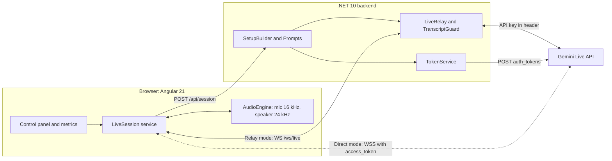

# Gemini Live API demo: control room

A voice call with Maya, the AI support agent of a fictional airline, plus a control panel that shows how each Live API setting changes latency, interruption and security. Built for the talk *Building Real-Time Conversational AI: Lessons from the Gemini Live API* at DevFest Malta 2026.

You call as a passenger about a cancelled flight, a delayed bag or a flight change. Comino Air, the passenger and the booking are all made up. The architecture follows the speaking partner at [deutschexam.ai](https://deutschexam.ai).

| Part | Stack |
|---|---|
| `backend/` | .NET 10 Minimal API. Holds the API key, builds the setup, mints tokens, runs the relay |
| `frontend/` | Angular 21 with signals. Mic capture, playback, control panel, metrics |
| `scripts/smoke-test.mjs` | Checks the paths the talk relies on, using text only |
| `tests/mock-gemini.mjs` | Local stand-in for the Live API, for tests and offline UI work |

## Setup

You need Node 22+, the .NET 10 SDK, Chrome and a [Gemini API key](https://aistudio.google.com/apikey).

```bash
npm run setup       # creates .env, installs packages
# put your key in .env: GEMINI_API_KEY=...
npm run dev         # backend on :5199, frontend on :4200
```

Open <http://localhost:4200> in Chrome and press **Start conversation**. Use a headset, or read the tips under [Stage notes](#stage-notes).

## Test it

```bash
npm test                  # backend + smoke test against the mock. No key or network needed
npm run smoke             # same checks against real Gemini. Needs npm run dev running
npm run smoke:all-models  # also tries each model in the panel
```

`npm test` proves our wiring and our reading of the protocol. Only `npm run smoke` proves it against the real API, so **run it before you present**. It checks that:

1. the system instruction reaches the model through the relay, and audio comes back
2. the setup locked inside an ephemeral token is honoured in direct mode
3. session resumption keeps the conversation across a new connection
4. the server guard blocks a typed attack
5. a hidden reminder between turns does not break the session

## Configuration

All configuration lives in `.env`, which git ignores. See [`.env.example`](.env.example).

| Variable | Default | Purpose |
|---|---|---|
| `GEMINI_API_KEY` | none | Required. Stays on the backend |
| `GEMINI_API_VERSION` | `v1beta` | API version for tokens and sockets |
| `GEMINI_BASE_URL` | Google's endpoint | Point at the mock with `http://localhost:9099` |
| `LIVE_DEFAULT_MODEL` | `gemini-3.8-live` | Used if the UI sends no model |
| `LIVE_DEFAULT_VOICE` | `Kore` | Used if the UI sends no voice |
| `BACKEND_PORT` | `5199` | Also update `frontend/proxy.conf.json` if you change it |

## Architecture



### Two connection modes

| | Relay | Direct (what deutschexam.ai uses) |
|---|---|---|
| Path | Browser ⇄ .NET ⇄ Gemini | Browser ⇄ Gemini |
| Credential | API key, on the server only | Single-use ephemeral token |
| System prompt | Server only | Locked inside the token, so server only |
| Latency | One extra hop | Lowest. Google says client-to-server generally performs better |
| Server can see the conversation | Yes: guard and re-anchoring work | No |

### A session, step by step

1. The browser posts the panel's settings to `POST /api/session`.
2. `SetupBuilder` turns them into the Live API setup message, and `Prompts` layers the system instruction.
3. **Relay:** the browser redeems a one-time ticket at `/ws/live`, and the backend connects to Gemini and sends the setup. **Direct:** the backend mints a token with the setup inside, and the browser connects to Gemini with it.
4. After `setupComplete`, a hidden text turn makes Maya open. The mic stays closed until she finishes.
5. Mic audio flows as 16 kHz PCM. Model speech returns as 24 kHz PCM and is scheduled for gapless playback.
6. On `interrupted`, the client clears its local audio queue.

Settings marked "applies live" change immediately. Everything else is part of the setup message, which is fixed for a session, so the UI offers **Apply and reconnect**.

### Layout

```text
backend/
  Program.cs            Endpoints
  LiveSettings.cs       Panel settings, plus model, voice and call scenario lists
  SetupBuilder.cs       Settings → Live API setup message
  Prompts.cs            Layered system instruction and steering notices
  TokenService.cs       Ephemeral token with locked setup
  LiveRelay.cs          Bidirectional WebSocket relay, guard and re-anchoring
  TranscriptGuard.cs    Regex checks on transcripts
frontend/src/app/
  live/live-session.service.ts   WebSocket, protocol and metrics
  live/audio-engine.service.ts   Mic capture and playback
  live/models.ts                 Settings, experiments and attack phrases
  ui/                            Control panel, conversation and insights
frontend/public/worklets/pcm-capture.js   Audio thread: PCM chunks and voice level
```

## The experiments

Each experiment button resets to the baseline, applies one change, and shows what to try. Experiments reconnect, so Maya forgets the caller: click **Send as caller** to verify again. The demo keeps the caller record in the prompt so that you can hear it leak. In a real system, fetch it through a tool after your server has verified the caller.

| Experiment | Change | What you should see |
|---|---|---|
| Baseline | Tuned defaults | Your reference latency |
| Buffered mic | 1 s chunks | Slower replies, from buffering alone |
| Impatient VAD | 150 ms silence | The AI cuts you off when you pause |
| Patient VAD | 1500 ms silence | Time to find your reference, with higher latency |
| Ignore "interrupted" | No playback flush | The AI talks over you |
| No echo cancellation | AEC and noise suppression off | On speakers, the AI interrupts itself |
| Half-duplex mic | Mic gated during AI speech | You cannot interrupt |
| Push to talk | Automatic VAD off | Reliable in a noisy room |
| Corporate script | Plain-voice layer off, formal instruction on | A long policy monologue |
| Plain phone voice | Plain-voice layer on | Short replies, one step at a time |
| No guardrails | Persona and caller record only | Reads out the phone and email on file. Gemini 3.8 still refuses most role and prompt attacks |
| Prompt guardrails only | Layered prompt, no server guard | The prompt alone has to hold |
| Prompt + server guard | Adds guard and re-anchoring | Guard events appear in the transcript |
| Resume after a drop | Resumption on | The AI remembers the caller and the flight |
| No resumption | Resumption off | The caller has to verify again |

Model replies vary from run to run, so treat "what you should see" as the likely result. The latency tile measures from the last mic level above a threshold to the first audio chunk, so it includes your VAD silence setting.

## What real Gemini taught us

The mock hid both of these, so test against the real API before you trust a demo.

- `turnComplete` can arrive after your playback queue is already empty. If your "finished speaking" check only runs when the queue changes, it never runs again.
- Close the old connection properly before you resume. If you abort it, Gemini rejects the handle with `1008 session is already connected to an existing client`. This client also waits for the old socket to close, and retries a few times.

## Stage notes

- Run `npm run smoke` on the venue's network, and record a backup video of the demo.
- Use a headset or a directional mic. Laptop speakers plus a room make the echo experiment happen by accident.
- Noisy room: use **Push to talk**, or type in the text box. Typed input and attack buttons need no mic.
- `gemini-3.8-live` always has proactive audio on, so it may stay quiet when it decides speech is not meant for it.

## Limitations

This is a local demo, on purpose:

- The backend binds to localhost and has no authentication or rate limits. Do not deploy it as is.
- The panel lets the browser choose settings, including an extra prompt instruction. A production backend must decide these itself.
- The regex guard is a teaching device. It only sees speech after the model has heard it.
- The Chrome-only audio path uses a 16 kHz `AudioContext`. Other browsers may need a resampler.

## References

- [Live API capabilities](https://aistudio.google.com/docs/live-api/capabilities), [session management](https://aistudio.google.com/docs/live-api/session-management), [ephemeral tokens](https://aistudio.google.com/docs/live-api/ephemeral-tokens), [best practices](https://aistudio.google.com/docs/live-api/best-practices)
- [Live API reference](https://aistudio.google.com/api-reference/live), [Gemini 3.8 Live](https://aistudio.google.com/docs/models/gemini-3.8-live)
